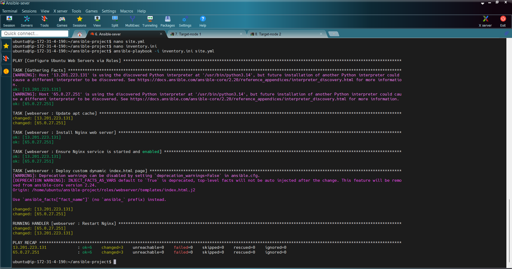
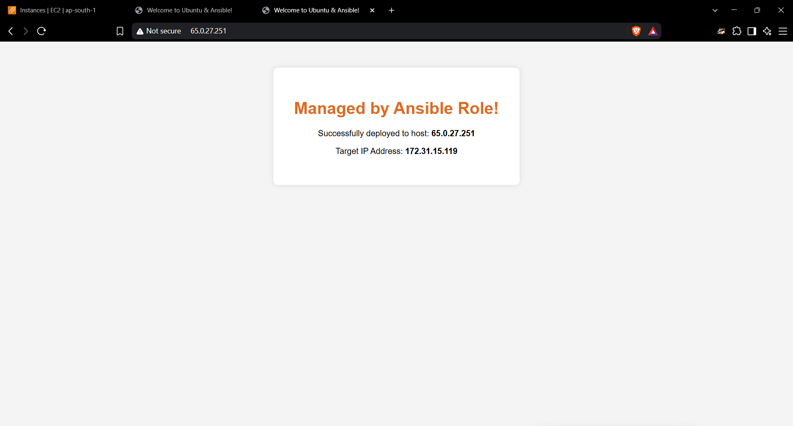
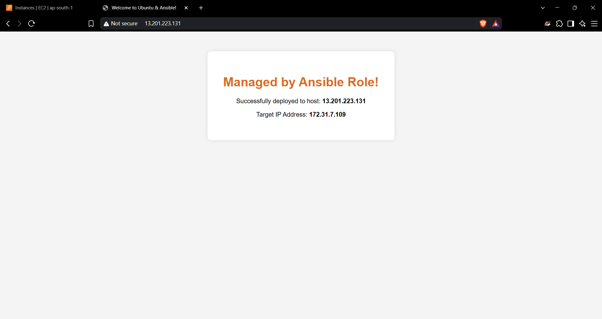

# Ansible Multi-Node EC2 Automation

Automate Nginx installation and configuration across multiple AWS EC2 Ubuntu servers using Ansible, reusable roles, Jinja2 templates, and SSH key-based authentication.

## Project Overview

This project uses three AWS EC2 instances: one Ansible Control Node and two Managed Target Nodes. The Control Node connects to both targets over SSH and runs an Ansible playbook to install Nginx, ensure the service is enabled and running, and deploy a custom HTML page that displays host information.

## Objectives

- Provision three Ubuntu EC2 instances on AWS.
- Configure an Ansible Control Node.
- Set up SSH key-based (passwordless) authentication to both managed nodes.
- Manage multiple servers through an Ansible inventory.
- Create a reusable Ansible role for Nginx.
- Deploy a dynamic HTML page using a Jinja2 template.
- Validate the deployment using Ansible output and a web browser.

## Architecture

```text
                         AWS Cloud
                             |
                  +-----------------------+
                  | Ansible Control Node  |
                  | Ubuntu + Ansible      |
                  +-----------+-----------+
                              |
                         SSH (Port 22)
                              |
                   +----------+----------+
                   |                     |
          +--------v--------+   +--------v--------+
          | Managed Node 1  |   | Managed Node 2  |
          | Ubuntu + Nginx  |   | Ubuntu + Nginx  |
          +--------+--------+   +--------+--------+
                   |                     |
                HTTP :80              HTTP :80
                   |                     |
            Custom web page       Custom web page
```

## Technologies Used

- **AWS EC2** — Cloud virtual machines
- **Ubuntu Server 26.04 LTS** — Operating system used for the instances
- **Ansible** — Configuration management and automation
- **Nginx** — Web server
- **YAML** — Ansible task and playbook definitions
- **Jinja2** — Dynamic HTML templating
- **SSH** — Secure remote access
- **Git and GitHub** — Version control and project documentation

## Infrastructure Requirements

| Component | Configuration |
|---|---|
| Cloud provider | AWS |
| EC2 instances | 3 |
| Operating system | Ubuntu Server 26.04 LTS |
| Instance type | `t3.micro` |
| Control Node | Ansible installed |
| Managed Target Nodes | Configured by Ansible |
| SSH port | 22 |
| HTTP port | 80 |

## Project Structure

```text
ansible-project/
├── inventory.ini
├── site.yml
├── roles/
│   └── webserver/
│       ├── tasks/
│       │   └── main.yml
│       ├── handlers/
│       │   └── main.yml
│       └── templates/
│           └── index.html.j2
├── screenshots/
│   ├── ansible-playbook-success.png
│   ├── target-node-1.png
│   └── target-node-2.png
└── README.md
```

- `inventory.ini` — lists the managed target nodes.
- `site.yml` — runs the Ansible role against the `webservers` group.
- `roles/webserver/tasks/main.yml` — installs and configures Nginx and deploys the template.
- `roles/webserver/handlers/main.yml` — restarts Nginx when notified.
- `roles/webserver/templates/index.html.j2` — defines the dynamic web page.
- `screenshots/` — contains the playbook output and browser verification screenshots.
- `README.md` — documents the project setup, implementation, and validation.

## Implementation

### 1. Provision the EC2 Instances

Launch three EC2 instances in AWS:

- One Control Node
- Two Managed Target Nodes

Use Ubuntu Server 26.04 LTS and the `t3.micro` instance type, as used in this project. Configure security groups to allow SSH (port 22) from a trusted source and HTTP (port 80) for web access.

### 2. Install Ansible on the Control Node

Connect to the Control Node and install Ansible:

```bash
sudo apt update
sudo apt install ansible
```

Verify the installation:

```bash
ansible --version
```

### 3. Create the Ansible Project

Create the project directory and initialize the role:

```bash
mkdir -p ~/ansible-project
cd ~/ansible-project
ansible-galaxy init roles/webserver
```

### 4. Configure SSH Key-Based Authentication

SSH key-based authentication allows the Control Node to connect to managed nodes without entering an SSH password for every connection.

1. Create or select an SSH key pair on the Control Node.
2. Add the Control Node's public key to the `ubuntu` user's `~/.ssh/authorized_keys` file on each managed target. Use the EC2 key or another secure bootstrap method to establish the initial access.
3. Ensure the `.ssh` directory and `authorized_keys` file have appropriate ownership and permissions.
4. Test SSH access to each target from the Control Node.

For a key pair generated on the Control Node, the public key can be displayed with:

```bash
cat ~/.ssh/id_ed25519.pub
```

After the public key has been installed on each target, test the connections:

```bash
ssh ubuntu@TARGET_1_IP
ssh ubuntu@TARGET_2_IP
```

Replace the placeholders with the current target addresses. Exit each session with `exit`.

> **Security:** Never commit private keys (`.pem`, `id_ed25519`, or similar), passwords, or other secrets to GitHub. Keep private keys on the machine that needs them and restrict access to them.

### 5. Configure the Inventory

Create `inventory.ini` in the project root:

```ini
[webservers]
65.0.27.251 ansible_user=ubuntu
13.201.223.131 ansible_user=ubuntu
```

The inventory above uses the public IP addresses shown in the project's actual `inventory.ini`. Update them if the EC2 public IP addresses change.

Test Ansible connectivity:

```bash
ansible webservers -i inventory.ini -m ping
```

Both hosts should return a successful `pong` response.

### 6. Create the Nginx Role Tasks

Define `roles/webserver/tasks/main.yml`:

```yaml
---
- name: Update apt cache
  apt:
    update_cache: yes

- name: Install Nginx web server
  apt:
    name: nginx
    state: present

- name: Ensure Nginx service is started and enabled
  service:
    name: nginx
    state: started
    enabled: yes

- name: Deploy custom dynamic index.html page
  template:
    src: index.html.j2
    dest: /var/www/html/index.nginx-debian.html
    owner: root
    group: root
    mode: '0644'
  notify: Restart Nginx
```

These tasks refresh the package cache, install Nginx, ensure the service is running and enabled at boot, and deploy the HTML template.

### 7. Create the Jinja2 Template

Create `roles/webserver/templates/index.html.j2`:

```html
<!DOCTYPE html>
<html>
<head>
  <title>Welcome to Ubuntu &amp; Ansible!</title>
</head>
<body style="font-family: Arial; text-align: center; margin-top: 50px; background-color: #f4f4f4;">
  <div style="background: white; padding: 40px; display: inline-block; border-radius: 8px; box-shadow: 0 0 10px rgba(0,0,0,0.1);">
    <h1 style="color: #DD6B20;">Managed by Ansible Role!</h1>
    <p>Successfully deployed to host: <strong>{{ inventory_hostname }}</strong></p>
    <p>Target IP Address: <strong>{{ ansible_default_ipv4.address | default('N/A') }}</strong></p>
  </div>
</body>
</html>
```

The Jinja2 variables populate the page with host-specific information for each managed node.

### 8. Configure the Handler

Define `roles/webserver/handlers/main.yml`:

```yaml
---
- name: Restart Nginx
  service:
    name: nginx
    state: restarted
```

The handler restarts Nginx when the template task reports a change.

### 9. Create the Playbook

Create `site.yml` in the project root:

```yaml
---
- name: Configure Ubuntu Web Servers via Roles
  hosts: webservers
  become: yes
  roles:
    - webserver
```

### 10. Run the Playbook

Run the deployment from the Ansible project directory:

```bash
ansible-playbook -i inventory.ini site.yml
```

Review the play recap and check that both hosts report `failed=0`.

## Deployment Results

### 1. Ansible Playbook Execution

The captured play recap shows both managed nodes completed without failures. Each host reports `ok=6`, `changed=3`, `unreachable=0`, and `failed=0`.



### 2. Managed Target Node 1

The browser screenshot shows the custom page served by the first target. It displays the Ansible-managed heading, the host value, and the target's private IP address.



### 3. Managed Target Node 2

The second browser screenshot shows the custom page served by the other managed target, demonstrating that the same role was applied to both servers.



## Validation Commands

Check Ansible connectivity:

```bash
ansible webservers -i inventory.ini -m ping
```

Check the Nginx service on both managed nodes:

```bash
ansible webservers -i inventory.ini -b -m command -a "systemctl is-active nginx"
```

Open each target's current public IP in a browser:

```text
http://TARGET_1_PUBLIC_IP
http://TARGET_2_PUBLIC_IP
```

Confirm that the page loads on both targets and displays the expected host-specific values.

## Key Learnings

- Provisioning and accessing AWS EC2 instances
- Ubuntu server administration
- Installing and using Ansible
- SSH key-based authentication
- Managing hosts through an inventory
- Reusable Ansible roles, tasks, and handlers
- Jinja2 templating
- Automated Nginx deployment across multiple servers
- Validating configuration-management runs

## Author

**Athul C**

DevOps project using AWS EC2, Ubuntu, Ansible, and Nginx.
